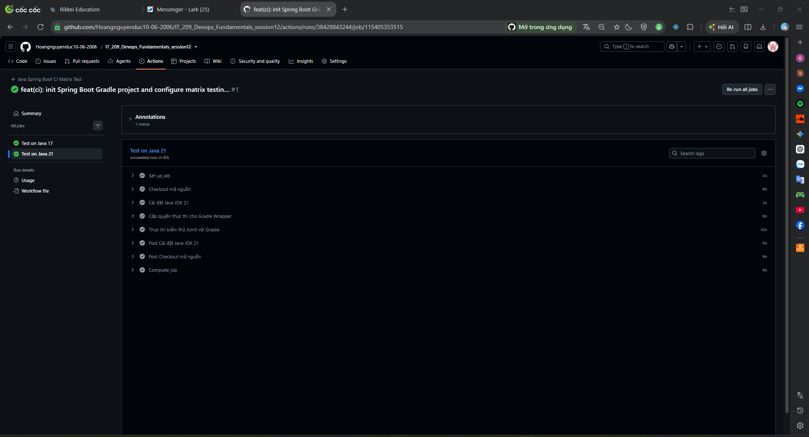

# BÁO CÁO THỰC HÀNH CI/CD: KIỂM THỬ ĐA PHIÊN BẢN JAVA VỚI MATRIX STRATEGY (GITHUB ACTIONS)

> **Môn học:** IT-209 – DevOps Fundamentals  
> **Bài thực hành:** Session 12 – Bài 1 (Exercise 1)  
> **Đường dẫn nộp bài:** `homework/session_12/ex1/`  
> **Môi trường CI Runner:** Ubuntu Latest (`ubuntu-latest`)  
> **Matrix Java Versions:** Java 17 & Java 21 (Eclipse Temurin)  
> **Build Tool:** Gradle Wrapper (`gradlew`)  

---

## 1. Yêu cầu đề bài

1. Trong thư mục mã nguồn dự án Java Spring Boot (Gradle), tạo tệp kịch bản `.github/workflows/ci-matrix.yml`.
2. Khai báo sự kiện kích hoạt khi `push` vào nhánh `main`.
3. Định nghĩa Job `test-matrix` sử dụng từ khóa `strategy.matrix`:
   - Định nghĩa mảng phiên bản Java: `java-version: ['17', '21']`.
   - Sử dụng `actions/checkout@v5`.
   - Cài đặt Java với `actions/setup-java@v5`, truyền biến `${{ matrix.java-version }}`, distribution: `'temurin'` và cache: `'gradle'`.
   - Cấp quyền thực thi: `chmod +x gradlew`.
   - Thực thi kiểm thử: `./gradlew test`.
4. Kiểm tra:
   - Đẩy code lên GitHub, truy cập tab Actions.
   - Xác nhận Job `test-matrix` tự động rẽ nhánh thành 2 sub-job chạy song song (`test-matrix (17)` và `test-matrix (21)`) và đều tích xanh (**Success**).
5. Sản phẩm nộp bài:
   - Tệp kịch bản `.github/workflows/ci-matrix.yml` (và `homework/session_12/ex1/ci-matrix.yml`).
   - Ảnh chụp màn hình tab Actions hiển thị luồng Matrix Test 2 sub-job thành công.

---

## 2. Cấu hình kịch bản Workflow CI Matrix (`.github/workflows/ci-matrix.yml`)

Nội dung kịch bản workflow:

```yaml
name: Java Spring Boot CI Matrix Test

on:
  push:
    branches: [ "main" ]

jobs:
  test-matrix:
    name: Test on Java ${{ matrix.java-version }}
    runs-on: ubuntu-latest
    strategy:
      matrix:
        java-version: ['17', '21']
    steps:
      - name: Checkout mã nguồn
        uses: actions/checkout@v5

      - name: Cài đặt Java JDK ${{ matrix.java-version }}
        uses: actions/setup-java@v5
        with:
          java-version: ${{ matrix.java-version }}
          distribution: 'temurin'
          cache: 'gradle'

      - name: Cấp quyền thực thi cho Gradle Wrapper
        run: chmod +x gradlew

      - name: Thực thi kiểm thử JUnit với Gradle
        run: ./gradlew test
```

---

## 3. Giải thích chi tiết các thành phần trong Workflow

| Thành phần / Cú pháp | Ý nghĩa kỹ thuật |
|-----------------------|------------------|
| `name: Java Spring Boot CI Matrix Test` | Tên hiển thị của workflow trên giao diện tab Actions của GitHub. |
| `on.push.branches: [ "main" ]` | Event Trigger: Kích hoạt pipeline CI tự động mỗi khi có commit mới được push lên nhánh `main`. |
| `jobs.test-matrix` | Tên định danh (Job ID) của công việc kiểm thử ma trận. |
| `strategy.matrix` | Khai báo chiến lược chạy ma trận (Matrix Strategy). GitHub Actions sẽ tự động nhân bản công việc thành các sub-job độc lập dựa trên tổ hợp các biến được định nghĩa. |
| `java-version: ['17', '21']` | Mảng chứa các phiên bản Java cần kiểm thử. Với 2 phần tử, GitHub Actions sẽ tạo ra đúng 2 sub-job song song: một job cho Java 17 và một job cho Java 21. |
| `name: Test on Java ${{ matrix.java-version }}` | Tên hiển thị linh động cho từng sub-job, giúp phân biệt rõ ràng: `Test on Java 17` và `Test on Java 21`. |
| `runs-on: ubuntu-latest` | Môi trường máy ảo runner thực thi job: Ubuntu phiên bản mới nhất do GitHub quản lý. |
| `uses: actions/checkout@v5` | Action chính thức của GitHub để clone toàn bộ mã nguồn của repository vào không gian làm việc của runner. |
| `uses: actions/setup-java@v5` | Action cài đặt môi trường Java Development Kit (JDK). |
| `java-version: ${{ matrix.java-version }}` | Truyền giá trị phiên bản Java động từ ma trận cho action cài đặt đúng JDK tương ứng với từng sub-job. |
| `distribution: 'temurin'` | Sử dụng bản phân phối OpenJDK Eclipse Temurin (Adoptium) chuẩn doanh nghiệp và có hiệu năng cao. |
| `cache: 'gradle'` | Tự động cache các gói thư viện/dependencies tải bởi Gradle giữa các lần chạy, tối ưu thời gian build và giảm băng thông mạng. |
| `run: chmod +x gradlew` | Cấp quyền thực thi (`execute`) cho tập lệnh `gradlew` trên Linux runner, tránh lỗi `Permission denied`. |
| `run: ./gradlew test` | Lệnh gọi Gradle Wrapper để biên dịch mã nguồn và thực thi toàn bộ JUnit tests (`src/test/java`). Trả về exit code 0 nếu tất cả test cases đều PASS. |

---

## 4. Cơ chế hoạt động của Matrix Strategy trong GitHub Actions

1. **Khái niệm Matrix Build:**
   - Matrix testing là cơ chế cho phép chạy kiểm thử ứng dụng đồng thời trên nhiều môi trường khác nhau (nhiều hệ điều hành, nhiều phiên bản runtime/ngôn ngữ, hoặc các trình duyệt khác nhau) chỉ với **một tệp khai báo duy nhất**.
   - Thay vì phải copy và tạo nhiều job thủ công (`test-java-17`, `test-java-21`), `strategy.matrix` giúp tái sử dụng mã kịch bản và giảm thiểu sai sót.

2. **Cách luồng chạy được khởi tạo:**
   - Khi có sự kiện `push` lên nhánh `main`, GitHub Actions Engine phân tích cấu hình `strategy.matrix`.
   - Ma trận phát hiện mảng `java-version` có 2 giá trị `['17', '21']`.
   - Engine lập tức cấp phát **2 máy ảo runner riêng biệt** (`ubuntu-latest`) và khởi chạy 2 sub-job song song:
     - **Sub-job 1:** Biến `${{ matrix.java-version }}` nhận giá trị `'17'` $\rightarrow$ Cài JDK 17 $\rightarrow$ Chạy `./gradlew test`.
     - **Sub-job 2:** Biến `${{ matrix.java-version }}` nhận giá trị `'21'` $\rightarrow$ Cài JDK 21 $\rightarrow$ Chạy `./gradlew test`.
   - Kết quả tổng thể của `test-matrix` chỉ thành công (tích xanh) khi **cả 2 sub-job** đều hoàn thành với trạng thái **Success**.

---

## 5. Các bước thực hiện đẩy mã nguồn và kiểm tra

### Bước 1: Khởi tạo Git repository (nếu chưa có) và commit mã nguồn
```bash
git init
git add .
git commit -m "feat(ci): add CI matrix test workflow for Java 17 and 21"
```

### Bước 2: Liên kết với Remote Repository trên GitHub và đẩy mã nguồn
```bash
git branch -M main
# Thay bằng URL repository của bạn trên GitHub:
git remote add origin https://github.com/<username>/<repo_name>.git
git push -u origin main
```

### Bước 3: Kiểm tra luồng chạy trên tab Actions
1. Mở trình duyệt, truy cập vào repository trên GitHub.
2. Bấm vào tab **Actions**.
3. Chọn workflow run vừa được kích hoạt bởi commit mới nhất.
4. Xác nhận:
   - Job `test-matrix` tự động chia nhánh thành 2 sub-job:
     - `Test on Java 17` (hoặc `test-matrix (17)`)
     - `Test on Java 21` (hoặc `test-matrix (21)`)
   - Cả hai sub-job đều chạy thành công và hiển thị dấu tích xanh.

---

